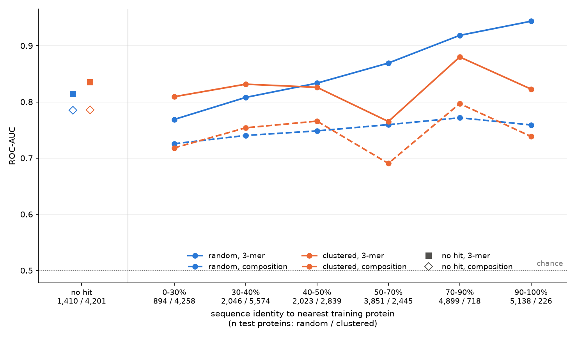

# Homology inflation in protein classifiers

If a test protein has a close relative in the training set, a model can score well just by
recognising the relative. Its measured performance then says little about proteins unlike
anything it has seen. This project measures how big that effect is. The same
classifiers are trained and tested twice, once on a **random** split and once on a
**clustered** split, where no test protein shares an MMseqs2 cluster (30% identity, 80% coverage)
with any training protein. Both test sets have the same size and class balance.

The main task is enzyme vs non-enzyme on reviewed UniProt (Swiss-Prot) proteins.

## Main results (enzyme vs non-enzyme, 20,261 test proteins per split)

| model | random split | clustered split | gap |
|---|---|---|---|
| nearest-neighbour lookup (MCC) | 0.953 | 0.799 | 0.154 |
| 3-mer logistic regression (ROC-AUC) | 0.886 | 0.816 | 0.070 |
| amino-acid composition LR (ROC-AUC) | 0.759 | 0.743 | 0.016 |

- The random split leaks: 78.9% of its test proteins share a cluster with a training protein (0% for the clustered split).
- Under the random split, 3-mer AUC rises steadily with identity to the nearest training protein: 0.769 below 30% identity, 0.944 above 90%.
- Composition features barely see homology, so they lose little on the clustered split.



*Test ROC-AUC of the logistic-regression models, by sequence identity of each test protein to
its nearest training protein. Blue: random split. Orange: clustered split. Solid: 3-mer
features. Dashed: amino-acid composition. Points on the left are test proteins with no MMseqs2
hit in the training set. The numbers under each band are test proteins per band (random / clustered).*

[WRITEUP.md](WRITEUP.md) explains the method in full, gives all results, and covers an
earlier experiment on DeepSol solubility data, where the gap did not appear and why.

## Layout

```
run.py               runs the whole study
homology/
  settings.py        all parameters (clustering thresholds, length limits, C grids, identity bands)
  load.py            read the two UniProt files, label, filter
  cluster.py         MMseqs2 clustering and search
  split.py           matched random and clustered splits
  features.py        amino-acid composition and 3-mer features
  models.py          nearest-neighbour lookup and logistic regression
  bands.py           performance by identity band, figure
  report.py          prints results and saves them to results/log.txt
data/                the two UniProt files used (gzipped)
results/             tables, figure and log
archive/deepsol/     earlier solubility experiment (notebooks)
```

## Running

Python 3.14 with `pip install -r requirements.txt`, and
[MMseqs2](https://github.com/soedinglab/MMseqs2) on your `PATH` (results made with commit
`564f40d8857f4eca4e1dfe100c67c155b1933e70`). From the repository root:

```
python run.py
```

This takes about 6 minutes on 16 threads, prints the results, and writes them to `results/`.
The clustering thresholds are at the top of `homology/settings.py`. Re-running on the committed
data reproduces every number in `results/` exactly.

## Data

Reviewed UniProtKB proteins, downloaded on 30 Oct 2026 with the fields Entry, Entry Name,
Sequence and EC number:

- `data/enzymes.tsv.gz`: `(reviewed:true) AND (cc_catalytic_activity_exp:*)`, 50,160 proteins
- `data/non_enzymes.tsv.gz`: `(reviewed:true) NOT (ec:*) AND (cc_function:*) AND (existence:1)`, 65,708 proteins

A protein is labelled an enzyme if its EC number field is non-empty. UniProt changes with every
release, so the same queries now return slightly different files. That is why the files used
are included.
